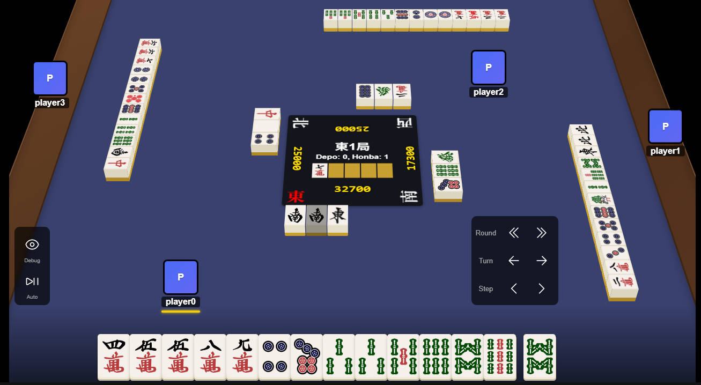
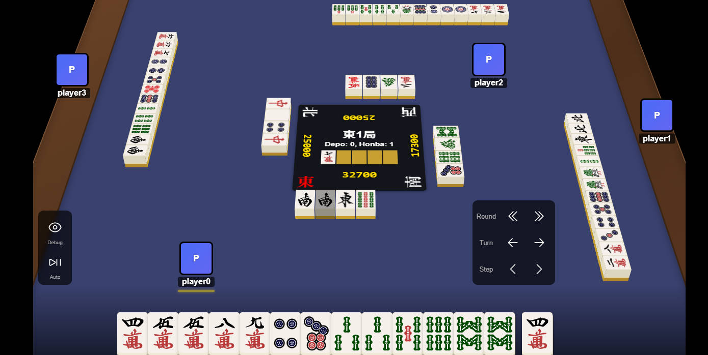
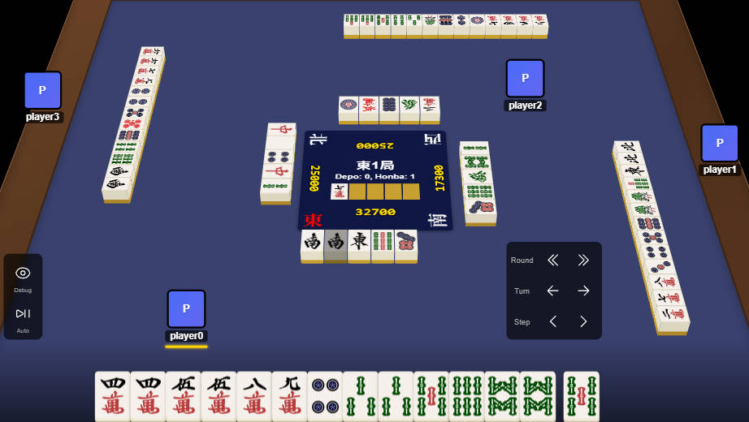

Model qwen3:8b



### 1. 局面背景

場風：東風  
自風：東風  
局數：東一局  
本場：0  
巡目：第4巡  
分數：32700 / 17300 / 25000 / 25000  
手牌：4萬 5萬 5萬 8萬 9萬 4筒 7筒 3索 3索 5索 6索 8索 8索 9索  
摸牌：未提供  
副露：無  
牌型特徵：3索對子、8索對子；4萬與5萬重複，形成搭子。  
寶牌指示牌為7萬，因此8萬為普通寶牌。

### 2. 棄牌決策

實際棄牌：9索（9s）
牌效推薦：4筒（4p）
推薦依據：兩者均為3向聽，但4筒棄牌後入章數44高於9索的43，符合評估器對相同向聽數下優先選擇更高入章數的策略。

### 3. 兩種棄牌分析

**實際棄牌：9索（9s）**  
牌效結果：3向聽，入章數43。  
策略影響：保留4筒、7筒、8索、9索等牌，形成4萬-5萬搭子與5索-6索搭子，但4筒與7筒為孤立牌，可能影響後續組牌靈活性。

**替代棄牌：4筒（4p）**  
牌效結果：3向聽，入章數44。  
策略影響：棄出4筒後，保留7筒與9索，並維持3索對子與8索對子，同時4萬-5萬搭子與5索-6索搭子仍完整，孤立牌減少，整體牌型更緊湊。

### 4. 綜合解釋

兩種棄牌均達成3向聽，但4筒棄牌後入章數略高，且保留更多潛在搭子與對子，使牌型結構更優化。評估器在相同向聽數下優先選擇更高入章數的棄牌，因此4筒為更符合效率排名的選擇。

<br><br>



### 1. 局面背景

場風：東風  
自風：東風  
局數：東一局  
本場：1  
巡目：第5巡  
分數：32700 / 17300 / 25000 / 25000  
手牌：4萬 4萬 5萬 5萬 8萬 9萬 4筒 7筒 3索 3索 5索 6索 8索 8索  
摸牌：未提供  
副露：無  
牌型特徵：4萬、5萬、3索、8索為對子；8萬、9萬、5索、6索為搭子。  
寶牌指示牌為7萬，因此8萬為普通寶牌。

### 2. 棄牌決策

實際棄牌：7筒（7p）  
牌效推薦：4筒（4p）  
推薦依據：兩者均達2向聽，入章數相同。  
~~4筒為手牌中唯一未形成對子的筒子~~ (incorrect)，保留可增加搭子靈活性。

### 3. 兩種棄牌分析

**實際棄牌：7筒（7p）**  
牌效結果：2向聽，入章數13。  
策略影響：棄7筒後，4筒成為孤立牌，但保留8萬與9萬搭子，以及5索與6索搭子。

**替代棄牌：4筒（4p）**  
牌效結果：2向聽，入章數13。  
策略影響：棄4筒後，7筒成為孤立牌，但保留4萬、5萬對子，以及8索、8索對子。

### 4. 綜合解釋

實際棄牌與替代棄牌均達2向聽且入章數相同，評估器視之為同等效率。  
~~棄7筒後保留8萬與9萬搭子，而棄4筒後保留4萬與5萬對子~~，兩者在結構上無明顯優劣。  
因無進一步評估指標，選擇任一棄牌均符合效率優先原則。

==============================


### 1. 局面背景

場風：東風  
自風：東風  
局數：東一局  
本場：0  
巡目：第6巡  
分數：32700 / 17300 / 25000 / 25000  
手牌：4萬 4萬 5萬 5萬 8萬 9萬 4筒 3索 3索 5索 5索 6索 8索 8索  
摸牌：未提供  
副露：無  
牌型特徵：4萬、5萬、3索、5索為對子；8萬9萬、6索8索為搭子。寶牌指示牌為7萬，因此8萬為普通寶牌。

### 2. 棄牌決策

實際棄牌：4筒（4p）
牌效推薦：4筒（4p）
推薦依據：兩者向聽數與入章數完全相同，評估器判定為同等效率。手牌已具備多對子與搭子，棄牌後仍維持聽牌狀態。

### 3. 兩種棄牌分析

**實際棄牌：4筒（4p）**
牌效結果：1向聽，入章數8。
策略影響：保留8萬9萬搭子與6索8索搭子，並維持4萬、5萬、3索、5索對子。棄牌後仍具備寶牌8萬的潛在價值。

**替代棄牌：4筒（4p）**
牌效結果：1向聽，入章數8。
策略影響：與實際棄牌效果相同，無差異。手牌結構未受影響，仍保持聽牌狀態。

### 4. 綜合解釋

實際棄牌與推薦棄牌為同一選項，評估器判定為同等效率。手牌已具備完整對子與搭子，棄牌後仍維持聽牌狀態，且保留寶牌8萬的潛在價值。此情況下，無需選擇其他棄牌，因所有選項均達成相同評估結果。

<h2> Deepseek-r1:8b


### 1. 局面背景

場風：東風  
自風：東風  
局數：東一局  
本場：0  
巡目：第4巡  
分數：32700 / 17300 / 25000 / 25000  
手牌：4萬 5萬 5萬 8萬 9萬 4筒 7筒 3索 3索 5索 6索 8索 8索 9索  
摸牌：未提供  
副露：無  
牌型特徵：手牌包含兩個對子（3索、8索），以及多個搭子（4萬5萬、8萬9萬、5索6索）。赤五萬（5mr）未出現，因此無赤寶牌。

### 2. 棄牌決策

實際棄牌：9索  
牌效推薦：4筒  
推薦依據：打出4筒後，手牌仍為3向聽，但入章數略高（44 vs 43）。根據牌塊分析，保留4筒可形成搭子，且其餘牌型未受顯著影響。

### 3. 兩種棄牌分析

**實際棄牌：9索**  
牌效結果：3向聽，入章數43。  
策略影響：打出9索後，手牌中索子花色的搭子減少，但未破壞其他搭子結構。保留的牌型仍包含3索對子和8索對子，以及筒子花色的4筒和7筒。

**替代棄牌：4筒**  
牌效結果：3向聽，入章數44。  
策略影響：打出4筒後，手牌中筒子花色的搭子（4筒7筒）被破壞，但未影響其他花色的搭子。保留的牌型仍包含3索對子和8索對子，以及萬子花色的搭子。

### 4. 綜合解釋

打出9索與打出4筒均維持3向聽狀態，但4筒的入章數略高（44 > 43），因此評估器認為4筒是更優的選擇。然而，兩者均未顯著改善手牌結構或減少潛在危險，因此整體策略影響不明顯。

==================================================


=== LLM COMMENTARY ===

### 1. 局面背景

場風：東風  
自風：東風  
局數：東一局  
本場：0  
巡目：第5巡  
分數：32700 / 17300 / 25000 / 25000  
手牌：4萬 4萬 5萬 5萬 8萬 9萬 4筒 7筒 3索 3索 5索 6索 8索 8索  
摸牌：未提供  
副露：無  
牌型特徵：手牌已形成多對對子（4萬、5萬、3索、8索），  
以及兩個搭子（8萬9萬、5索6索）。  
場風與自風相同為東風，  
無役牌潛力。

### 2. 棄牌決策

實際棄牌：7筒（7p）  
牌效推薦：4筒（4p）  
推薦依據：打出4筒後仍為2向聽，  
與打出7筒後相同。  
但根據評估器，  
保留4筒可維持更高的入章數（ukeire=13）。

### 3. 兩種棄牌分析

**實際棄牌：7筒（7p）**  
牌效結果：2向聽，入章數13。  
策略影響：保留4筒、5筒、6筒、  
~~8筒、9筒等牌~~ (factual hallucination)，  
仍有機會形成搭子。  
但打出7筒後，  
手牌中7筒的潛在搭子減少。

**替代棄牌：4筒（4p）**  
牌效結果：2向聽，入章數13。  
策略影響：保留4筒會導致手牌中  
4筒的潛在搭子減少，  
但保留其他牌張的改善空間更大。  
根據牌塊分析，  
保留4筒後，  
手牌仍可形成多個搭子。

### 4. 綜合解釋

打出7筒與打出4筒均導致2向聽，  
但保留4筒可維持更高的入章數，  
因此根據評估器的效率標準，  
打出4筒是較佳選擇。  
然而，  
兩者均未改變手牌的向聽狀態，  
因此無法確定哪種棄牌更具策略優勢。

==================================================


=== LLM COMMENTARY ===

### 1. 局面背景

場風：東風  
自風：東風  
局數：東一局  
本場：0  
巡目：第6巡  
分數：32700 / 17300 / 25000 / 25000  
手牌：4萬 4萬 5萬 5萬 8萬 9萬 4筒 3索 3索 5索 5索 6索 8索 8索  
摸牌：未提供  
副露：無  
牌型特徵：手牌已形成4對子，包括4萬、5萬、3索、5索，以及8索對子。赤五萬為赤寶牌，但未形成役牌。

### 2. 棄牌決策

實際棄牌：4筒  
牌效推薦：4筒  
推薦依據：打出4筒後，手牌仍為4向聽，與最佳效率棄牌結果一致。

### 3. 兩種棄牌分析

**實際棄牌：4筒**  
牌效結果：~~4向聽，入章數8~~ (Numerical hallucination)。  
策略影響：保留~~赤五萬~~ (Factual hallucination) 的潛在搭子，以及8索的搭子可能性。

```
"actual_discard": "4p",
    "actual_evaluation": {
      "discard": "4p",
      "shanten": 1,
      "ukeire": 8,
      "effective_tiles": {
        "8m": 3,
        "9m": 3,
        "6s": 2
      },
```

**替代棄牌：4筒**
牌效結果：4向聽，入章數8。
策略影響：與實際棄牌結果相同，無明顯優劣。

### 4. 綜合解釋

打出4筒後，手牌仍維持4向聽狀態，且入章數為8，符合評估器的效率標準。由於兩種棄牌選擇均導致相同結果，評估器無法區分其優劣，因此4筒是最佳效率選擇之一。

<br>

# Preliminary Evaluation of LLM-Generated Riichi Mahjong Commentary

**Models:** Qwen3 8B and DeepSeek-R1 8B  
**Dataset:** Three consecutive discard decisions (Turns 4–6)  
**Status:** Exploratory qualitative analysis; not a statistically representative benchmark.

## 1. Objective and feasibility

Evaluate whether local LLMs can turn structured Mahjong decision-evaluator evidence into readable, accurate, and useful Traditional Chinese discard commentary. Both models generated the required four-part commentary and often copied numerical values correctly. Nevertheless, they also produced incorrect tile descriptions, invalid inferences, unsupported strategic claims, and unhelpful comparisons.

**Key finding:** Numerical accuracy, factual correctness, and explanatory relevance are separate dimensions. Correctly copying shanten and ukeire does not guarantee that the accompanying explanation is valid.

## 2. Common error categories and examples

| Error category              | Qwen3 8B                                                                                                           | DeepSeek-R1 8B                                                                                         | Annotation                                   |
| --------------------------- | ------------------------------------------------------------------------------------------------------------------ | ------------------------------------------------------------------------------------------------------ | -------------------------------------------- |
| Game-state inconsistency    | Turn 4: says **9索 is retained** after discarding 9索                                                              | Turn 5: describes **retaining 4筒** under the option that discards 4筒                                 | Contradicted by candidate post-discard hand  |
| Mahjong-rule error          | Turn 6: calls **1向聽** a **聽牌** state                                                                           | Turn 4: calls **4筒–7筒** a 搭子                                                                       | Rule contradiction                           |
| Numerical inconsistency     | Turn 6: reports **1向聽**, but also calls it 聽牌 (a semantic error, not a numeric-copy error)                     | Turn 6: reports **4向聽** although evaluator reports **1向聽**                                         | Check numbers separately from interpretation |
| Unsupported strategic claim | Turn 4: claims discarding 4筒 preserves more potential 搭子/對子 without comparative evidence                      | Turn 4: claims neither option significantly reduces danger, although no danger evaluation was supplied | Not established by evidence                  |
| Irrelevant comparison       | Turn 5: contrasts structures shared by both discard outcomes                                                       | Turn 5: discusses generic future 搭子 possibilities without explaining a **13 vs 13** ukeire tie       | Low explanatory relevance                    |
| Incorrect tie handling      | Turn 6: says **all options** share the same evaluation, although only actual and selected best are shown identical | Turn 5: says 4筒 has **higher ukeire** despite **13 vs 13**                                            | Incorrect or overgeneralized comparison      |
| Invented tile               | No comparably clear example in these three excerpts                                                                | Turn 5: says 5筒、6筒、8筒、9筒 are retained though absent; Turn 6 invents 赤五萬                      | Tile hallucination                           |

### Important annotation cautions

- **6索–8索 is a valid 嵌張搭子**, waiting for 7索. Do **not** label it an invalid taatsu.
- **4筒–7筒 is not a taatsu**: it cannot be completed into a three-tile sequence with one additional tile.
- A reference to a **future possible draw** is not automatically a hallucination. The error arises when the model states that a tile **is already held or retained** when it is not.
- The hand shown in Turn 6 contains **five pairs** (4萬, 5萬, 3索, 5索, 8索), not four.
- **1向聽 is not 聽牌**; 聽牌 corresponds to 0向聽.
- The Turn 6 evaluator excerpt explicitly reports `shanten: 1` and `ukeire: 8` for discarding 4p. These are the ground-truth _input fields for LLM-copy accuracy_, pending independent evaluator validation.
- The three decisions are consecutive turns, so they are useful for debugging but not independent samples.

## 3. Evaluation metrics

| Metric                   | Definition / example                                                                      | Calculation                                                                                 | Assessment method                                        |
| ------------------------ | ----------------------------------------------------------------------------------------- | ------------------------------------------------------------------------------------------- | -------------------------------------------------------- |
| Numerical field accuracy | Did the commentary report correct shanten, ukeire, round, scores, turn?                   | Correct checked fields / all checked fields                                                 | Parse output; compare with evaluator JSON                |
| Tile-state consistency   | Did it claim a discarded or absent tile was retained?                                     | Valid checked tile-state claims / checked tile-state claims                                 | Hand-state validator + human review                      |
| Mahjong-rule accuracy    | Is a claimed 搭子, 對子, 寶牌 or 聽牌 state valid?                                        | Correct checked rule claims / checked rule claims                                           | Rule checks + human annotation                           |
| Comparative consistency  | Does it correctly identify better/worse/tie based on evaluator criteria?                  | Correct comparison conclusions / checked conclusions                                        | Deterministic comparison of `(shanten, -ukeire)`         |
| Claim groundedness       | Are factual and strategic claims supported by input or retrieved evidence?                | Supported claims / all assessed claims; also report contradicted and unsupported separately | Claim-level annotation, optionally assisted by LLM judge |
| Explanatory relevance    | Does the explanation identify what actually distinguishes the discards, or explain a tie? | Average human rating (1–5); report distribution                                             | Human rubric                                             |
| Format compliance        | Does output include four sections and required fields?                                    | Fully compliant outputs / total outputs                                                     | Markdown/section parser                                  |
| Generation latency       | How long does each model take?                                                            | Median and p90 seconds per decision                                                         | Timed inference on same machine                          |

### Explanatory relevance rubric

| Score | Meaning                                                                       |
| ----- | ----------------------------------------------------------------------------- |
| 1     | Misleading or largely irrelevant; fails to explain decision                   |
| 2     | A few relevant observations but mostly generic or repetitive                  |
| 3     | Identifies main numerical comparison but adds unnecessary claims              |
| 4     | Clear, relevant, and mostly evidence-grounded                                 |
| 5     | Concise, accurate, and directly explains the meaningful difference **or tie** |

### Claim annotation example

| Generated claim       | Label        | Reason                                                 |
| --------------------- | ------------ | ------------------------------------------------------ |
| 「棄9索後保留9索」    | Contradicted | 9索 is discarded                                       |
| 「4筒7筒為搭子」      | Contradicted | Invalid one-tile-away sequence structure               |
| 「棄4筒後入章數44」   | Supported    | Matches Turn 4 evaluator evidence                      |
| 「棄4筒保留更多搭子」 | Unsupported  | No evidence that candidate-specific structures improve |
| 「8萬9萬為搭子」      | Supported    | Valid adjacent-tile taatsu                             |

**Annotation principle:** Distinguish **contradicted** (demonstrably false), **unsupported** (not established by available evidence), **contextual but irrelevant**, and **supported and relevant**. Avoid counting unsupported claims as proven false.

## 4. Possible correction methods and how to test them

| Intervention              | Proposed change                                                                       | Hypothesis                                          | Controlled test                                            |
| ------------------------- | ------------------------------------------------------------------------------------- | --------------------------------------------------- | ---------------------------------------------------------- |
| Model comparison          | Qwen3 4B, Qwen3 8B, DeepSeek-R1 8B; optionally Gemma                                  | Model capabilities affect errors and latency        | Same decisions, evidence, prompt, decoding policy          |
| Prompt refinement         | Forbid invented tiles, unsupported advantages, and forced comparisons                 | Fewer contradictions                                | Baseline vs revised prompt                                 |
| Comparative evidence      | Python supplies tie/better/worse, numerical deltas, and shared vs distinct structures | Better comparison consistency and relevance         | With vs without comparative fields                         |
| RAG                       | Retrieve rules and strategy knowledge relevant to a decision                          | Better Mahjong-rule accuracy and useful explanation | Same model with vs without retrieval                       |
| Deterministic validation  | Check numerical fields, tile identities, and known rule constraints                   | Detect objectively checkable errors                 | Precision, recall, F1 on annotated errors                  |
| Feedback and regeneration | Supply detected contradictions and request corrected output                           | Lower post-correction error rate                    | Compare initial vs revised commentary; record cost/latency |

**RAG limitation:** Retrieved general strategy knowledge cannot by itself establish which discard is superior in a particular hand. Evaluator evidence must determine shanten/ukeire comparisons. RAG should provide definitions and relevant strategy principles, not replace the evaluator.

## 5. Experimental plan

1. **Build a diverse benchmark:** Start with approximately 30–50 decisions from multiple games. Include distinct shanten levels, tied and unequal rankings, identical actual/best discards, dora/yakuhai situations, and varied hand structures.
2. **Freeze the baseline:** Save exact evaluator JSON, prompt, few-shot examples, model versions, generation settings, and outputs for reproducibility.
3. **Run model comparison:** Evaluate Qwen3 4B, Qwen3 8B, and DeepSeek-R1 8B on the same benchmark; collect accuracy, relevance, hallucination categories, and latency. Do not claim statistical superiority from three cases.
4. **Implement automated checks:** Parse output fields and compare against evaluator evidence; detect obvious tile contradictions and invalid comparisons.
5. **Create human-annotated reference labels:** Annotate a subset at claim level and rate relevance. If possible, use two annotators and report agreement.
6. **Run ablation experiments:** Add prompt refinement, comparative evidence, RAG, and post-generation validation separately to measure each intervention's effect.
7. **Audit evaluator correctness:** Validate shanten, ukeire, dora, and block-analysis outputs independently so evaluator bugs are not counted as LLM mistakes.

## 6. Supervisor discussion summary

> **Feasibility:** Both Qwen3 8B and DeepSeek-R1 8B generate readable, structured Riichi Mahjong commentary from evaluator evidence.
>
> **Observed problems:** Game-state contradictions, Mahjong-rule errors, incorrect numerical interpretations, unsupported strategy claims, and low-relevance comparisons.
>
> **Research direction:** Evaluate factual correctness, comparative consistency, groundedness, and explanatory usefulness separately. Compare models under controlled conditions, then test whether structured evidence, RAG, and validation improve performance.
>
> **Next milestone:** A diverse benchmark with reproducible model outputs, automatic metrics, and a small human-annotated evaluation set.

**Proposed research question:** _How do model selection, structured grounding, and retrieved Mahjong strategy knowledge affect the factual accuracy and explanatory relevance of LLM-generated Riichi Mahjong discard commentary?_
